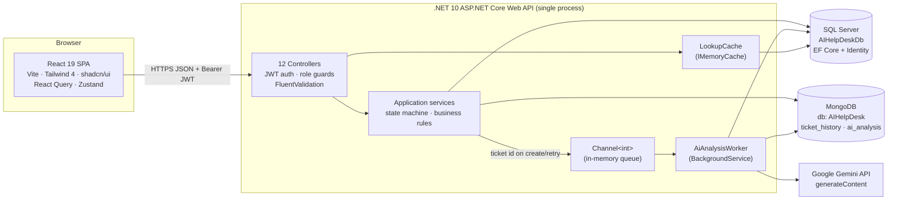
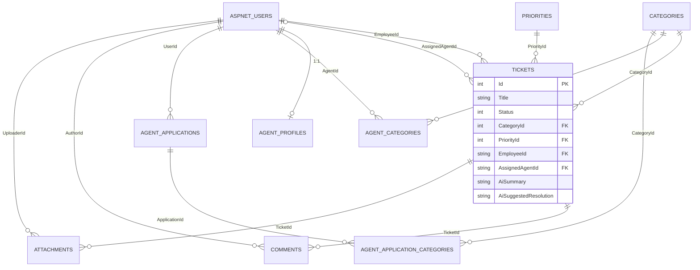
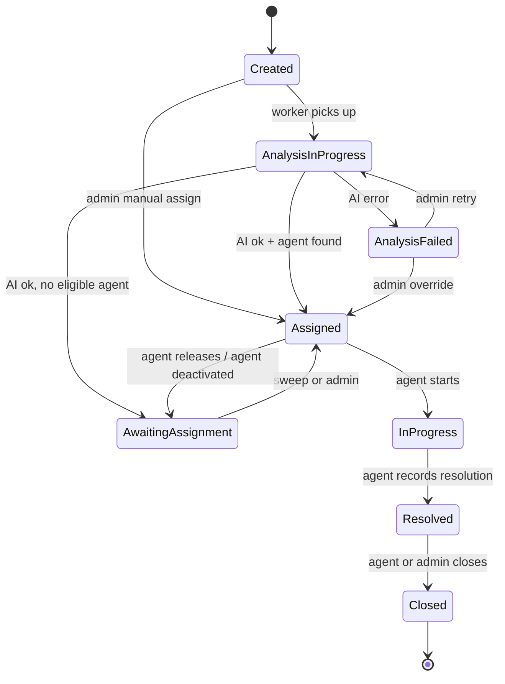

# AI Help Desk & Ticket Management System

> An internal IT support platform with **AI-powered triage**: employees raise tickets in plain language — the system classifies, prioritizes, summarizes and routes them automatically.
>
> **React 19 · .NET 10 Clean Architecture · SQL Server + MongoDB · Google Gemini**

## Table of Contents

1. [Overview](#1-overview)
2. [Tech Stack](#2-tech-stack)
3. [System Architecture](#3-system-architecture)
4. [Project Structure](#4-project-structure)
5. [Getting Started](#5-getting-started)
6. [Configuration Reference](#6-configuration-reference)
7. [Roles & Permissions](#7-roles--permissions)
8. [API Reference](#8-api-reference)
9. [Database Design](#9-database-design)
10. [How It Works](#10-how-it-works)
11. [Security](#11-security)
12. [Testing](#12-testing)
13. [Useful Commands](#13-useful-commands)
14. [Deployment & Roadmap](#14-deployment--roadmap)

---

## 1. Overview

**AI Help Desk** is a full-stack support-ticket platform with AI-assisted triage:

- An **Employee** submits a ticket with just a **title and a description** — no category, no priority.
- A **background worker** analyzes the description with **Google Gemini**, which returns a category, priority, a short summary and a suggested resolution — **constrained to the category/priority lists configured by the Admin** (the AI can never invent values).
- The ticket is then **auto-assigned** to the least-loaded Agent who is active, available and linked to that category.
- The ticket moves through an enforced **state machine** (Created → Analysis → Assigned → In Progress → Resolved → Closed), and every step is **audited in MongoDB**.
- If the AI or the auto-assignment fails, an **Admin** can retry the analysis, override it, or assign manually — the system never dead-ends.

### User roles

| Role | Who | What they do |
|---|---|---|
| **Employee** | Any internal staff member | Raises tickets, tracks their own tickets, applies to become an Agent |
| **Agent** | Support staff | Works auto-assigned tickets through the lifecycle (start / resolve / close / release), manages availability, capacity and work categories |
| **Admin** | IT management | Manages users, categories and priorities; approves Agent applications; oversees all tickets; retries / overrides failed AI analysis; views dashboards & reports |

### Key features

- JWT authentication with role-based access control (ASP.NET Core Identity)
- AI triage with a **three-layer constraint** (prompt → response-schema enums → code validation)
- **Async processing** — ticket creation returns instantly; analysis runs on a background worker (in-memory `Channel<int>` queue)
- **Smart auto-assignment** + assignment sweep that re-offers waiting tickets whenever capacity frees up
- **MongoDB audit trail** — every status change, assignment and AI attempt; raw AI responses stored for debugging
- **Admin retry & manual override** for failed AI analysis
- **Live deactivation** — a deactivated user's still-valid JWT is rejected on the next request
- Caching of category/priority lookups with cache-aside invalidation
- Responsive React SPA with role-based navigation and live polling while the AI works

---

## 2. Tech Stack

| Layer | Technology | Purpose |
|---|---|---|
| Frontend | React 19 + TypeScript | UI framework, type-safe client |
| Frontend build | Vite 7 | Dev server (port 5173) and production bundler |
| Styling | Tailwind CSS 4 + shadcn/ui (Radix) | Utility-first styling + accessible components |
| Backend | .NET 10 / ASP.NET Core Web API | REST API, authentication, business logic |
| Relational DB | SQL Server (EF Core 10) | System of record: users, tickets, lookups, comments |
| Document DB | MongoDB (Driver 3.12) | Append-only logs: ticket audit history, raw AI responses |
| Auth | ASP.NET Core Identity + JWT Bearer | Password hashing, roles, 30-minute stateless tokens |
| AI | Google Gemini REST API (v1beta) | Ticket classification, summary, suggested resolution |
| Logging | Serilog | Console + daily rolling file logs |
| API docs | Swagger (Swashbuckle) | Interactive docs in Development |

### Frontend libraries (highlights)

| Package | Purpose |
|---|---|
| `react-router` | Routing with protected, role-gated routes |
| `@tanstack/react-query` | Server-state caching, polling, mutations |
| `@tanstack/react-table` | Data tables (tickets, reports) |
| `axios` | HTTP client with Bearer + 401 interceptors |
| `zustand` | Auth session store (persisted to localStorage) |
| `react-hook-form` + `zod` | Form handling + validation |
| `sonner` / `lucide-react` / `date-fns` | Toasts, icons, dates |

Full dependency list: `frontend/package.json`.

### Backend NuGet packages (highlights)

| Project | Package | Purpose |
|---|---|---|
| API | `Microsoft.AspNetCore.Authentication.JwtBearer` 10.0.12 | JWT validation |
| API | `FluentValidation.AspNetCore` 11.3.1 | Automatic request-body validation |
| API | `Serilog.AspNetCore` 10.0.0 | Structured logging (console + files) |
| API | `Swashbuckle.AspNetCore` 7.3.1 | Swagger UI |
| Application | `FluentValidation` 12.2.0 | Business-rule validators |
| Infrastructure | `Microsoft.AspNetCore.Identity.EntityFrameworkCore` 10.0.12 | Identity on EF Core |
| Infrastructure | `Microsoft.EntityFrameworkCore.SqlServer` 10.0.12 | SQL Server provider |
| Infrastructure | `MongoDB.Driver` 3.12.0 | MongoDB client |
| Tests | `xunit` 2.9.3 + `Microsoft.EntityFrameworkCore.InMemory` 10.0.12 | Unit tests without real databases |

All backend projects target **net10.0**.

---

## 3. System Architecture

- The **React SPA** (Vite dev server, `http://localhost:5173`) talks only to the **.NET API** (`https://localhost:7124` / `http://localhost:5045`) using JSON + `Bearer` JWT.
- **SQL Server (EF Core)** is the system of record for all relational data.
- **MongoDB** stores two append-only log collections — `ticket_history` (audit trail) and `ai_analysis` (raw AI responses) — linked to SQL only by the ticket's integer ID. **No shared tables, no cross-database transactions.**
- A **background worker** (`AiAnalysisWorker`, a `BackgroundService`) consumes ticket IDs from an in-memory `Channel<int>` queue, calls **Gemini**, archives the raw result in MongoDB, updates the ticket in SQL Server, and runs the assignment algorithm.



### Backend pattern

Clean / layered architecture with a selective repository pattern:

```text
AIHelpDesk.API           → depends on Application + Infrastructure (composition root)
AIHelpDesk.Application   → depends on Domain (DTOs, service interfaces, validators, state machine)
AIHelpDesk.Domain        → depends on nothing (entities + enums only)
AIHelpDesk.Infrastructure→ depends on Application + Domain (EF Core, MongoDB, services, AI, worker)
AIHelpDesk.Tests         → references all of the above
```

- Plain services (no CQRS) with request/response DTOs; entities never cross the API boundary.
- Repository pattern for the two MongoDB stores; relational data via EF Core `AppDbContext`.
- Async background processing via `System.Threading.Channels` (unbounded, single reader).
- Cache-aside lookups (`LookupCache`, 6-hour expiry, invalidated on every write).

### Runtime processes (local development)

| Process | Port | Notes |
|---|---|---|
| SQL Server (LocalDB) | — | Database `AIHelpDeskDb`; migrations auto-applied on API startup |
| MongoDB | 27017 | Database `AIHelpDesk` (configurable) |
| .NET API | `https://localhost:7124`, `http://localhost:5045` | Swagger UI at `/swagger` (Development only) |
| Vite dev server | `http://localhost:5173` (strict) | Default CORS origin |

---

## 4. Project Structure

### Repository root

```text
AIHelpDesk/
├── AIHelpDesk.slnx        # .NET solution (5 backend projects)
├── .gitignore
├── README.md              # This file — official project documentation
├── backend/               # .NET solution (structure below)
└── frontend/              # React app (structure below)
```

### Backend

```text
backend/
├── AIHelpDesk.API/                     # Web host / composition root
│   ├── Program.cs                      # DI, auth, CORS, Swagger, Serilog, migrate + seed on startup
│   ├── Controllers/                    # 12 controllers: auth, tickets (employee/agent/admin),
│   │                                   #   admin, categories, priorities, comments, history, dashboard
│   ├── Middleware/
│   │   └── ExceptionHandlingMiddleware.cs  # global exception → RFC 7807 ProblemDetails
│   ├── Services/
│   │   ├── ITokenService.cs            # JWT creation interface
│   │   └── TokenService.cs             # HMAC-SHA256 JWT, 30-minute expiry
│   ├── appsettings.json
│   └── Properties/launchSettings.json
│
├── AIHelpDesk.Application/             # Use-cases: DTOs, interfaces, validators
│   ├── Admin/  AgentApplications/  AgentAssignment/  AgentProfile/
│   ├── Auth/  Categories/  Comments/  Dashboard/  Priorities/
│   ├── Tickets/                        # ticket DTOs, ITicketService, validators
│   └── Common/
│       ├── TicketStateMachine.cs       # allowed status-transition map (pure logic)
│       └── Interfaces/                 # IAiAnalysisService, repositories, ILookupCache
│
├── AIHelpDesk.Domain/                  # Pure domain model (zero dependencies)
│   ├── Entities/                       # Ticket, Comment, Attachment, Category, Priority,
│   │                                   #   AgentProfile, AgentCategory, AgentApplication (+Category)
│   └── Enums/                          # TicketStatus (8), TicketEventType (12),
│                                       #   AgentApplicationStatus (4)
│
├── AIHelpDesk.Infrastructure/          # All concrete implementations
│   ├── AI/GeminiAiAnalysisService.cs   # Gemini REST call + parse/validate
│   ├── BackgroundWorkers/AiAnalysisWorker.cs
│   ├── Cache/LookupCache.cs
│   ├── Identity/                       # ApplicationUser + IdentitySeeder
│   ├── Migrations/                     # 8 EF Core migrations
│   ├── MongoDB/MongoDbContext.cs       # IMongoDatabase + 2 typed collections
│   ├── Persistence/AppDbContext.cs     # IdentityDbContext + Fluent API
│   ├── Repositories/                   # TicketHistoryRepository, AiAnalysisRepository
│   └── Services/                       # 8 service implementations
│
└── AIHelpDesk.Tests/                   # xUnit unit tests
    ├── TestHelpers.cs                  # InMemory EF context + fake Mongo history repo
    ├── TicketStateMachineTests.cs
    ├── AgentAssignmentServiceTests.cs
    ├── AgentApplicationServiceTests.cs
    └── AgentProfileServiceTests.cs
```

### Frontend

```text
frontend/
├── package.json / package-lock.json    # dependencies + scripts (dev/build/lint/typecheck/test)
├── vite.config.ts                      # React + Tailwind plugins, "@" alias, port 5173 (strict)
├── vitest.config.ts                    # jsdom + MSW test setup
├── tsconfig*.json / eslint.config.js / .prettierrc.json / .nvmrc
├── components.json                     # shadcn config (style "radix-nova")
├── .env.example / .env.development     # VITE_API_BASE_URL
├── index.html
└── src/
    ├── main.tsx                        # bootstrap: restore session, providers, Toaster
    ├── App.tsx                         # all routes (public / protected / role-gated)
    ├── index.css                       # Tailwind 4 theme, CSS variables, Geist font
    ├── types/api.ts                    # shared wire types (PagedResult, TicketStatus, ...)
    ├── lib/
    │   ├── api-client.ts               # axios instance, Bearer + 401 interceptors
    │   ├── jwt.ts                      # JWT payload parser (claims → { id, email, roles })
    │   ├── query-client.ts             # QueryClient config + queryKeys factory
    │   ├── error-mapping.ts            # normalizes backend error shapes → ApiError
    │   └── toast.ts / dates.ts / url-filters.ts / utils.ts
    ├── stores/
    │   └── auth-store.ts               # Zustand session store (localStorage-persisted)
    ├── layouts/
    │   ├── app-layout.tsx              # sidebar shell, role-based nav, UserMenu
    │   └── guards.tsx                  # ProtectedRoute, RequireRole, primaryRole
    ├── components/
    │   ├── ui/                         # 20 shadcn/ui primitives
    │   └── shared/                     # 13 app-level components (badges, data-table,
    │                                   #   ai-banner, filter-bar, confirm-dialog, ...)
    ├── features/                       # feature-sliced modules (each: api.ts + hooks.ts)
    │   ├── auth/  tickets/  categories/  priorities/  dashboard/
    │   └── reports/  users/  agent-profile/  applications/
    ├── pages/                          # 22 route pages
    │   ├── login / register / not-found / unauthorized
    │   ├── admin-* (9 pages)
    │   ├── agent-* (4 pages)
    │   └── employee-* (5 pages)
    └── test/                           # MSW setup + smoke tests
```

---

## 5. Getting Started

### Prerequisites

| Requirement | Version | Notes |
|---|---|---|
| .NET SDK | 10.0 | `dotnet --version` |
| Node.js | >= 20.19 | `.nvmrc` pins 24 |
| SQL Server | LocalDB or any instance | dev connection uses `(localdb)\MSSQLLocalDB` |
| MongoDB | Community edition (local or Docker) | default `mongodb://localhost:27017` |
| Google Gemini API key | - | create one in Google AI Studio |

### 1. Clone

```bash
git clone <YOUR_GITHUB_REPOSITORY_URL>
cd AIHelpDesk
```

### 2. Backend — configure user secrets

```bash
dotnet user-secrets init --project backend/AIHelpDesk.API

dotnet user-secrets set "ConnectionStrings:DefaultConnection" "Server=(localdb)\MSSQLLocalDB;Database=AIHelpDeskDb;Trusted_Connection=True;TrustServerCertificate=True;" --project backend/AIHelpDesk.API

dotnet user-secrets set "MongoDB:ConnectionString" "mongodb://localhost:27017" --project backend/AIHelpDesk.API
dotnet user-secrets set "MongoDB:DatabaseName" "AIHelpDesk" --project backend/AIHelpDesk.API

dotnet user-secrets set "Jwt:Key" "<long random string, 32+ chars>" --project backend/AIHelpDesk.API
dotnet user-secrets set "Jwt:Issuer" "AIHelpDesk" --project backend/AIHelpDesk.API
dotnet user-secrets set "Jwt:Audience" "AIHelpDeskClient" --project backend/AIHelpDesk.API

dotnet user-secrets set "Gemini:ApiKey" "AIza..." --project backend/AIHelpDesk.API

dotnet user-secrets set "AdminSeed:Email" "admin@company.com" --project backend/AIHelpDesk.API
dotnet user-secrets set "AdminSeed:Password" "YOUR_STRONG_PASSWORD" --project backend/AIHelpDesk.API
dotnet user-secrets set "AdminSeed:FullName" "System Administrator" --project backend/AIHelpDesk.API
```

> The API **throws at startup** if `Jwt:Key/Issuer/Audience`, `MongoDB:ConnectionString` or `AdminSeed:Email/Password` are missing. The admin is seeded only if that email does not exist yet.
>
> Password policy: at least 8 characters with a digit, an uppercase, a lowercase and a non-alphanumeric character. **Never commit secrets to the repository** — user secrets for development, environment variables or Azure Key Vault for production.

### 3. Backend — run

```bash
dotnet build AIHelpDesk.slnx
dotnet run --project backend/AIHelpDesk.API
```

On startup the API:

1. applies pending EF Core migrations (8 total) — `AIHelpDeskDb` is created automatically,
2. seeds the `Admin`, `Agent` and `Employee` roles,
3. creates the seeded admin user if it does not exist.

It then listens on `https://localhost:7124` and `http://localhost:5045`; Swagger UI is at `/swagger` (Development only). MongoDB needs **no seeding** — its two collections are created on first write.

### 4. Frontend — run

```bash
cd frontend
npm install
npm run dev
```

Dev server: `http://localhost:5173` (strict). The API base URL comes from `VITE_API_BASE_URL` (default `http://localhost:5045`) — no `.env` file is required for the default setup.

### 5. Verify the full flow

1. Open `http://localhost:5173` -> log in with the seeded admin -> you land on `/admin`.
2. Create at least one **Category** and one **Priority** (the AI can only use configured values; the registration form needs at least one active category).
3. Create an **Agent** user (with work categories) and an **Employee** user.
4. Log in as the Employee -> create a ticket -> watch it move `Created -> AnalysisInProgress -> Assigned` with the AI summary appearing.
5. Log in as the Agent -> start / resolve / close the ticket.
6. Log in as the Admin -> open the ticket -> inspect the **audit timeline** (served from MongoDB).

---

## 6. Configuration Reference

All secrets are stored with `dotnet user-secrets` for local development (never committed).

| Key | Required | Default | Purpose |
|---|---|---|---|
| `ConnectionStrings:DefaultConnection` | yes | - | SQL Server connection (dev: `(localdb)\MSSQLLocalDB`, database `AIHelpDeskDb`) |
| `AdminSeed:Email` | yes | - | Email of the first Admin account (seeded if it does not exist) |
| `AdminSeed:Password` | yes | - | Password of the first Admin (must meet the Identity policy) |
| `AdminSeed:FullName` | no | `System Administrator` | Display name of the seeded Admin |
| `Jwt:Key` | yes | - | HMAC-SHA256 signing key (long random string) |
| `Jwt:Issuer` | yes | - | Token issuer (e.g. `AIHelpDesk`) |
| `Jwt:Audience` | yes | - | Token audience (e.g. `AIHelpDeskClient`) |
| `MongoDB:ConnectionString` | yes | - | e.g. `mongodb://localhost:27017` |
| `MongoDB:DatabaseName` | no | `AIHelpDesk` | MongoDB database name |
| `Gemini:ApiKey` | optional | - | Without it every AI analysis fails -> `AnalysisFailed` (convenient for testing the retry/override flow) |
| `Gemini:Model` | no | `gemini-2.0-flash-lite` | Gemini model to call |
| `Cors:AllowedOrigins` | no | `http://localhost:5173` | Comma-separated list of allowed origins |

Frontend environment (`.env.development` / `.env.example`):

| Variable | Default | Purpose |
|---|---|---|
| `VITE_API_BASE_URL` | `http://localhost:5045` | Base URL of the API |

---

## 7. Roles & Permissions

| Capability | Employee | Agent | Admin |
|---|:-:|:-:|:-:|
| Create tickets (own) | yes | - | - |
| View own tickets / comments | yes | - | - |
| Apply to become an Agent | yes | - | - |
| View assigned tickets | - | yes | - |
| Start / Resolve / Close / Release tickets | - | yes | - |
| Manage own availability / capacity / categories | - | yes | - |
| View all tickets + audit history | - | - | yes |
| Manual assign / override / retry analysis / close | - | - | yes |
| Manage users, roles, status (self + last-Admin protected) | - | - | yes |
| Approve / reject Agent applications | - | - | yes |
| Manage categories & priorities | - | - | yes |
| Dashboard metrics / reports | own scope | own scope | all |

## 8. API Reference

Base URL: `https://localhost:7124` (or `http://localhost:5045`) in development — all request bodies are JSON. **SQL** = SQL Server, **Mongo** = MongoDB, **both** = the request writes to both databases.

### Authentication & lookups

| Method | URL | Purpose | Body | Auth | DB |
|---|---|---|---|---|---|
| POST | `/api/auth/login` | Sign in -> JWT (30 min) | `{ email, password }` | none | SQL |
| POST | `/api/auth/register` | Register as Employee (+ optional Agent application) | `{ fullName, email, password, applyAsAgent, categoryIds?, agentMessage? }` | none | SQL |
| GET | `/api/categories/public` | Active categories (used by the register form) | - | none | SQL |
| GET | `/api/categories` | List categories (`?activeOnly`) | - | any | SQL |
| GET | `/api/categories/{id}` | One category | - | any | SQL |
| POST | `/api/categories` | Create category | `{ name, description? }` | Admin | SQL |
| PUT | `/api/categories/{id}` | Update category | `{ name, description? }` | Admin | SQL |
| PATCH | `/api/categories/{id}/status` | Activate / deactivate | `{ isActive }` | Admin | SQL |
| GET | `/api/priorities` | List priorities (`?activeOnly`) | - | any | SQL |
| GET | `/api/priorities/{id}` | One priority | - | any | SQL |
| POST | `/api/priorities` | Create priority | `{ name, level }` | Admin | SQL |
| PUT | `/api/priorities/{id}` | Update priority | `{ name, level }` | Admin | SQL |
| PATCH | `/api/priorities/{id}/status` | Activate / deactivate | `{ isActive }` | Admin | SQL |

### Tickets — Employee

| Method | URL | Purpose | Body | Auth | DB |
|---|---|---|---|---|---|
| POST | `/api/tickets/employee` | **Create ticket** (AI queued async) | `{ title, description }` | Employee | **both** |
| GET | `/api/tickets/employee` | Own tickets (filters, paged) | query: `page, pageSize, status, categoryId, priorityId, fromDate, toDate` | Employee | SQL |
| GET | `/api/tickets/employee/{id}` | One own ticket | - | Employee | SQL |

### Tickets — Agent

| Method | URL | Purpose | Body | Auth | DB |
|---|---|---|---|---|---|
| GET | `/api/tickets/agent` | Assigned tickets (filters, paged) | same query params | Agent | SQL |
| GET | `/api/tickets/agent/{id}` | One assigned ticket | - | Agent | SQL |
| PUT | `/api/tickets/agent/{id}/start` | Assigned -> InProgress | - | Agent | **both** |
| PUT | `/api/tickets/agent/{id}/resolve` | InProgress -> Resolved (+sweep) | `{ resolution }` | Agent | **both** |
| PUT | `/api/tickets/agent/{id}/close` | Resolved -> Closed (+sweep) | - | Agent | **both** |
| PUT | `/api/tickets/agent/{id}/release` | Assigned -> AwaitingAssignment (+sweep) | - | Agent | **both** |

### Tickets — Admin

| Method | URL | Purpose | Body | Auth | DB |
|---|---|---|---|---|---|
| GET | `/api/admin/tickets` | All tickets (filters incl. `agentInactive`, paged) | query as above | Admin | SQL |
| GET | `/api/admin/tickets/{id}` | Any ticket detail | - | Admin | SQL |
| PUT | `/api/admin/tickets/{id}/assign` | Manual assignment | `{ agentId }` | Admin | **both** |
| PUT | `/api/admin/tickets/{id}/override-analysis` | Fix a failed analysis (AnalysisFailed only) | `{ categoryId, priorityId, agentId? }` | Admin | **both** |
| POST | `/api/admin/tickets/{id}/retry-analysis` | Re-run AI analysis (AnalysisFailed only) | - | Admin | **both** |
| PUT | `/api/admin/tickets/{id}/close` | Force-close a resolved ticket | - | Admin | **both** |

### Comments, history & analytics

| Method | URL | Purpose | Body | Auth | DB |
|---|---|---|---|---|---|
| GET | `/api/tickets/{ticketId}/comments` | Ticket comments | - | any (ownership scoped) | SQL |
| POST | `/api/tickets/{ticketId}/comments` | Add a comment | `{ content }` | any (ownership scoped) | SQL |
| GET | `/api/tickets/{ticketId}/history` | **Audit trail (MongoDB)** | - | Admin | **Mongo** |
| GET | `/api/dashboard` | Dashboard metrics (agent-scoped for agents) | - | Admin, Agent | SQL |
| GET | `/api/reports` | Filtered, paged report | query: `page, pageSize, status, categoryId, priorityId, agentId, fromDate, toDate` | Admin, Agent | SQL |

### Admin — users & applications

| Method | URL | Purpose | Body | Auth | DB |
|---|---|---|---|---|---|
| GET | `/api/admin/users` | List users (`?role`) | - | Admin | SQL |
| POST | `/api/admin/users` | Create user (Agent requires `categoryIds`) | `{ fullName, email, password, role, categoryIds? }` | Admin | SQL |
| PUT | `/api/admin/users/{id}` | Update name / email | `{ fullName, email }` | Admin | SQL |
| PATCH | `/api/admin/users/{id}/status` | Activate / deactivate (self + last-Admin protected; deactivating an Agent requeues their unstarted tickets) | `{ isActive }` | Admin | **both** (when Agent) |
| PUT | `/api/admin/users/{id}/role` | Change Employee / Agent (syncs agent profile) | `{ role, categoryIds? }` | Admin | **both** (when demoted) |
| GET | `/api/admin/users/{id}` | One user | - | Admin | SQL |
| GET | `/api/admin/users/{id}/categories` | Agent's work categories | - | Admin | SQL |
| PUT | `/api/admin/users/{id}/categories` | Replace agent's categories (+sweep) | `{ categoryIds }` | Admin | **both** (sweep may write) |
| GET | `/api/admin/agent-applications` | List applications (`?status, page, pageSize`) | - | Admin | SQL |
| GET | `/api/admin/agent-applications/{id}` | One application | - | Admin | SQL |
| POST | `/api/admin/agent-applications/{id}/approve` | Approve (role swap + profile + categories, +sweep) | `{ categoryIds?, note? }` | Admin | **both** (sweep may write) |
| POST | `/api/admin/agent-applications/{id}/reject` | Reject (note recorded) | `{ note? }` | Admin | SQL |

### Employee — agent application / Agent — own profile

| Method | URL | Purpose | Body | Auth | DB |
|---|---|---|---|---|---|
| POST | `/api/agent-applications` | Apply to become an Agent | `{ categoryIds, message? }` | Employee | SQL |
| GET | `/api/agent-applications/mine` | Own most recent application | - | Employee | SQL |
| DELETE | `/api/agent-applications/mine` | Withdraw own pending application | - | Employee | SQL |
| GET | `/api/agent/me` | Own work profile | - | Agent | SQL |
| GET | `/api/agent/me/categories` | Own categories | - | Agent | SQL |
| PUT | `/api/agent/me/categories` | Replace own categories (+sweep) | `{ categoryIds }` | Agent | **both** (sweep may write) |
| PUT | `/api/agent/me/availability` | Availability / capacity cap (+sweep) | `{ isAvailable, maxOpenTickets? }` | Agent | **both** (sweep may write) |

Errors are returned as RFC 7807 `ProblemDetails` (`status`, `title`, `detail`, `instance`): 400 invalid argument / validation, 403 access denied, 404 not found, 401 invalid or inactive account, 409 business-rule violation, 500 unexpected.

---

## 9. Database Design

The two databases store **fundamentally different data**:

- **SQL Server** = *system of record*: relational, transactional business data (people, tickets, lookups, workflow state).
- **MongoDB** = *event log*: append-only history (audit trail, raw AI responses) — written once, never updated.

### Data ownership

| Data | DB | Why |
|---|---|---|
| Users, roles, password hashes (Identity tables) | SQL | Relational integrity; Identity's EF store; FK-referenced everywhere |
| `Ticket`, `Category`, `Priority`, `Comment`, `Attachment` (metadata) | SQL | Core entities: FKs, state-machine updates, dashboard/report aggregation |
| `AgentProfile`, `AgentCategory`, `AgentApplication (+Category)` | SQL | Transactional approval flow; join tables that drive assignment |
| **`ticket_history`** collection | Mongo | Immutable, append-only, unbounded audit trail, queried by `ticketId` — a textbook log workload |
| **`ai_analysis`** collection | Mongo | One document per AI attempt: full raw model output + parsed fields — irregular, bulk text, never updated |

### SQL Server (EF Core)

- Context: `AppDbContext : IdentityDbContext<ApplicationUser>` — 100% LINQ/EF, no raw SQL.
- 8 migrations, **auto-applied on startup**.
- Key constraints: `Priorities.Name` and `Priorities.Level` unique; `AgentProfiles` is 1:1 with the user (PK = FK); `AgentCategories` / `AgentApplicationCategories` have composite PKs; a filtered unique index on `AgentApplications.UserId` where `Status = 0` keeps one pending application per user.



### MongoDB

- Client: `MongoDB.Driver`; singleton `IMongoClient` + `MongoDbContext` (database name from `MongoDB:DatabaseName`).
- Two typed collections, flat documents, **no Mongo-to-Mongo references**; linked to SQL only by `ticketId` (a logical reference to `Tickets.Id`):

| Collection | Fields |
|---|---|
| `ticket_history` | `ticketId`, `eventType` (0-11), `oldValue?`, `newValue?`, `actorId?` (user id or `system`), `timestamp`, `details?` |
| `ai_analysis` | `ticketId`, `success`, `rawResponse?`, `parsedCategory?`, `parsedPriority?`, `parsedSummary?`, `parsedSuggestedResolution?`, `failureReason?`, `attemptNumber`, `timestamp` |

- Writes are single inserts; reads are `Find(ticketId).Sort(timestamp ascending)`. Nothing is ever updated or deleted.

### Consistency (honest assessment)

- Multi-table SQL changes run in one EF transaction.
- **No cross-database transactions** — SQL commits first, Mongo writes best-effort afterwards. A Mongo failure can leave an audit gap (the business data stays correct).
- The AI queue (`Channel<int>`) is in-memory: a restart mid-analysis leaves the ticket in `AnalysisInProgress` until an admin retries it.

---

## 10. How It Works

### Ticket lifecycle (state machine)

8 statuses with a fixed transition map (`TicketStateMachine` — illegal transitions throw -> HTTP 409):



### AI triage pipeline

1. `POST /api/tickets/employee` -> ticket inserted (SQL) + `Created` audit event (Mongo) + ticket ID enqueued on the `Channel<int>` -> **201 returned instantly**.
2. `AiAnalysisWorker` consumes the ID -> marks the ticket `AnalysisInProgress` -> calls Gemini with the ticket description.
3. **Three-layer constraint** (the AI can never invent values):
   - **Prompt** — only the active category/priority names (from cache) are listed.
   - **Response schema** — `responseSchema` with string **enums** for `category` / `priority` + JSON mime type.
   - **Validation** — parsed values are re-checked against the active SQL lists before acceptance.
4. Every attempt (success or failure) is archived in Mongo `ai_analysis` (raw response + parsed fields + attempt number).
5. Success -> category, priority, summary and suggested resolution are saved on the ticket -> **auto-assignment**. Failure -> `AnalysisFailed` (an admin can **retry** or **override**).

### Auto-assignment & sweep

Eligibility: agent linked to the ticket's category -> active user in the Agent role -> profile `IsAvailable` -> under `MaxOpenTickets` (Assigned + InProgress). Ranking: **fewest open -> longest idle -> stable id**.

`SweepAsync` re-offers every `AwaitingAssignment` ticket (oldest first) whenever capacity changes: resolve, close, release (excludes the releasing agent), availability/capacity change, category change, application approval, agent created, agent deactivated/demoted.

### Agent deactivation (requeue)

Deactivating or demoting an Agent:

1. removes the agent's category links,
2. marks the profile unavailable,
3. moves their unstarted (`Assigned`) tickets back to `AwaitingAssignment` with audit events,
4. keeps `InProgress` tickets (admins can flag them via `?agentInactive=true`),
5. runs a sweep so the freed capacity is picked up immediately.

Protections: an admin cannot deactivate themselves, and cannot deactivate the last active Admin.

---

## 11. Security

| Area | Implementation |
|---|---|
| Passwords | ASP.NET Core Identity salted hashes; policy: 8+ chars, digit, upper, lower, non-alphanumeric (enforced on the backend + mirrored in frontend forms) |
| Authentication | JWT HS256, 30-minute expiry; claims `sub`, `email`, `nameidentifier`, `role` |
| Live revocation | `OnTokenValidated` reloads the user on **every** request — a deactivated or deleted user gets 401 immediately, even with an unexpired token |
| Authorization | `[Authorize(Roles)]` per controller + ownership scoping in services (employees/agents never see others' data; the user id always comes from the JWT, never from the client) |
| Injection | 100% EF parameterized queries; Mongo via typed filter builders — user input never reaches either query language |
| Validation | FluentValidation auto-validation + DataAnnotations + EF length limits |
| CORS | Strict allow-list (default exactly `http://localhost:5173`) |
| Secrets | User secrets in development; the API throws at startup when required keys are missing; no secrets in source |
| Errors | Global middleware -> RFC 7807; business rules map to 400/403/404/409 |

Known gaps (tracked in the roadmap): no rate limiting/lockout on login, JWT stored in `localStorage` (XSS exposure), `ex.Message` exposed in 500 responses, no refresh tokens.

## 12. Testing

### Backend — xUnit (`backend/AIHelpDesk.Tests`)

Core logic is tested without real databases (EF InMemory context + a fake Mongo history repository, real service classes unmodified):

| Suite | Covers |
|---|---|
| `TicketStateMachineTests` | All allowed and denied status transitions |
| `AgentAssignmentServiceTests` | Eligibility, load-balancing order, sweep, release-excludes-self |
| `AgentApplicationServiceTests` | One-pending-per-user, approval role swap + profile + categories, reject / withdraw |
| `AgentProfileServiceTests` | Category diffs, availability/capacity, deactivation requeue |

### Frontend — Vitest + MSW

- `src/test/smoke.test.tsx` — render/submit smoke tests for Login and Register against a mocked API (MSW).
- Strict TypeScript (`npm run typecheck`) and ESLint 9 (`npm run lint`) are part of the workflow.

---

## 13. Useful Commands

```bash
# Backend
dotnet build AIHelpDesk.slnx
dotnet run --project backend/AIHelpDesk.API
dotnet test AIHelpDesk.slnx
dotnet restore AIHelpDesk.slnx

# EF Core migrations (the API auto-migrates on startup; these are for explicit control)
dotnet ef migrations add <Name> --project backend/AIHelpDesk.Infrastructure --startup-project backend/AIHelpDesk.API
dotnet ef database update --project backend/AIHelpDesk.Infrastructure --startup-project backend/AIHelpDesk.API

# User secrets
dotnet user-secrets list --project backend/AIHelpDesk.API

# Frontend
cd frontend
npm install
npm run dev          # Vite dev server (http://localhost:5173)
npm run build        # production bundle
npm run typecheck
npm run lint
npm test             # Vitest (single run)
```

## 14. Deployment & Roadmap

**Today (development)**: `dotnet publish` + Kestrel for the API; `npm run build` -> static `frontend/dist` (SPA — needs server rewrites for deep links).

**Planned**:

- Docker (API + databases, compose file)
- Azure: App Service + Azure SQL + MongoDB Atlas + Blob storage (attachments)
- GitHub Actions CI (build + `dotnet test` + `npm ci && npm test && npm run build`)

**Product roadmap**:

- [x] Authentication, roles, JWT, admin seeding
- [x] Categories & priorities management
- [x] Ticket lifecycle + state machine + comments
- [x] Gemini AI triage (constrained) + admin retry / override
- [x] Agent applications, approval flow, auto-assignment + sweep
- [x] Agent deactivation requeue, dashboards & reports
- [x] React frontend (all three role areas)
- [ ] Durable AI queue (RabbitMQ / outbox) so analyses survive restarts
- [ ] Real-time updates (SignalR) instead of polling
- [ ] Attachment upload + file storage end-to-end
- [ ] Rate limiting, refresh tokens, cookie-based sessions
- [ ] Mongo compound index `{ticketId: 1, timestamp: 1}` + log aggregation

